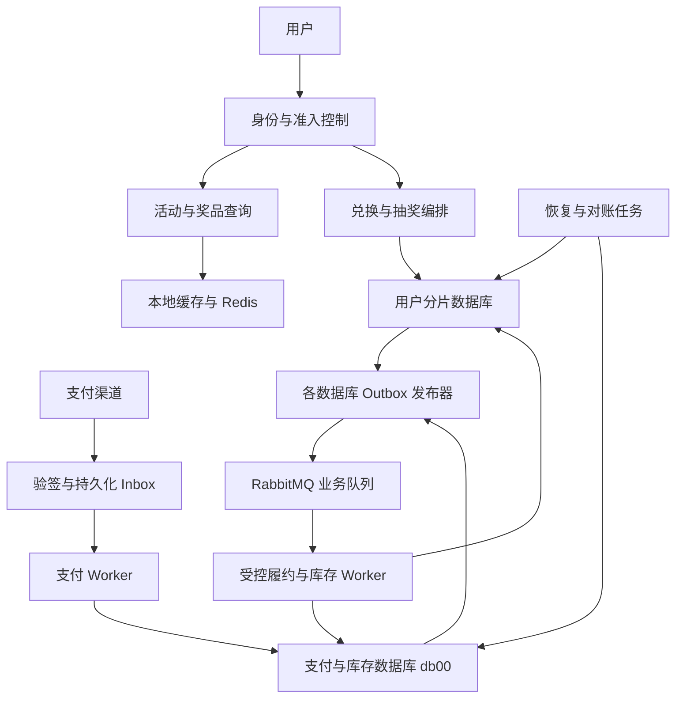
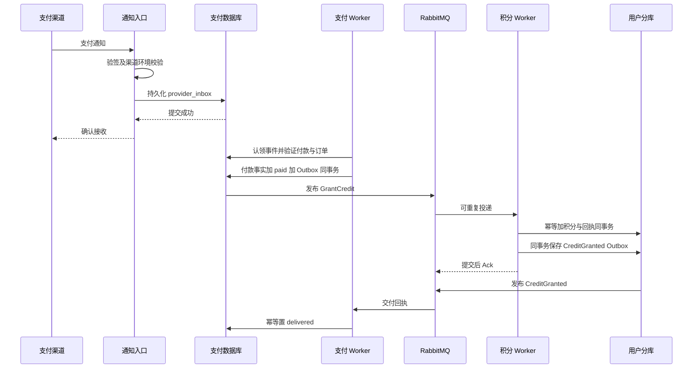

# BroMark 高并发积分支付与抽奖设计方案

日期：2026年10月15日

状态：设计草案，供评审与后续实施使用

改造对象：BroMark

参考项目：vivix-billing

本方案围绕活动开始时集中发生的签到返利、支付充值、积分兑换和抽奖，设计可恢复的交易链路，并用受控并发、缓存与资源隔离提高稳定处理能力。实施顺序是先保证账户、库存和履约正确，再依据实验定位瓶颈和扩展容量。

第一版保留 Java、Spring Boot、MySQL、Redis、RabbitMQ 和现有 DB Router。按用户分片处理账户交易，支付事实与全局奖品库存独立保存；跨数据库通过持久化命令、幂等处理和状态机推进。Redis 不保存唯一的余额或库存事实。

执行环境采用 MySQL 8.0 InnoDB，业务短事务使用 READ COMMITTED，关键读取显式加锁。恢复保证以数据库已确认提交不丢失为前提；RabbitMQ 使用持久化消息与经验证的持久队列配置，故障实验记录磁盘同步和副本设置。进程宕机、超时与消息重复纳入首版故障模型，数据库持久化副本整体丢失由备份恢复流程处理。

本文性能数值是实验负载和配置示例，不是项目已测结果。本文不声称现有代码已经具备拟设计能力。

## 一 目标与范围

### 业务场景

1. 活动开放前后，用户集中查询活动、签到领积分、兑换次数并抽奖。
2. 用户重复点击、客户端超时重试，同一笔兑换或抽奖可能同时进入多个实例。
3. 支付通知重复、乱序或延迟到达；付款已经成功，积分服务暂时不可用。
4. 进程在扣次数、预留库存、写中奖记录、发布消息等位置中断。
5. 某个热门奖品成为写热点；消费者处理速度低于新增任务速度。
6. 滚动发布、数据库变慢或 MQ 故障时，系统需要保留已受理业务，并限制新增压力。

### 第一版交付范围

- 账户、兑换、抽奖采用稳定业务请求身份，支持重复请求结果回放。
- 修复余额扣减、账户唯一性和事务异常传播；支持积分流水对账。
- 将支付事实接收、付款确认、积分发放分开，以 Inbox、Outbox 衔接。
- 实现可确认、可取消的库存预留与跨库抽奖恢复协议。
- 改造消息任务认领、发布确认、消费幂等、失败重试和业务恢复。
- 增加策略版本与本地缓存、入口准入、数据库和消费并发预算。
- 建立端到端压测、故障注入及账实校验。

支付部分先使用测试支付适配器或渠道沙盒验证通知、查单和履约协议。真实渠道接入需要实现对应验签、付款身份、金额币种和订单归属校验，通过渠道契约测试后才能开放；测试适配器不进入生产配置。

### 第一版不包含的能力

不实现商户结算、分账、跨用户转账、多期订阅、透支、自动处理已消费充值积分退款、在线分片扩容及冷热归档。它们分别涉及新的账务或迁移语义，不作为首版高并发能力的前置条件。

已付款的退款、撤销事件仍需持久化，并转人工核查状态；不自动回收已消费资产，不直接删除付款或积分记录。支付前到达的退款通知也必须保留并阻止无条件发放，待查询渠道事实后处理。

### 业务规则假设

首版使用单应用、单积分单位；积分最多两位小数，禁止负余额。一次抽奖消耗一次机会；取消仅允许发生在 RESULT_RECORDED 之前，按取消协议完成后退还机会。从 RESULT_RECORDED 开始只能继续确认、履约或转人工处理。库存不足时使用版本配置中的不限库存兜底结果，不重新随机抽取。

总剩余次数是累计可消费余额；日、月额度使用用户活动账户对应的自然日、自然月桶。业务时区固定为 Asia/Shanghai。SKU 对总次数及周期额度的增量沿用发布时配置，并写入订单快照。日、月表成为周期剩余额度的权威记录，主账户现有日月镜像不再作为并发扣减判据。

## 二 当前实现与改造依据

| 现有实现 | 对应缺口 | 本方案处理 |
| --- | --- | --- |
| 用户订单按 userId 路由，配置为两库、每库四张分表 | 分片后交易边界和缺少路由键的查询需要明确 | 保留分片，所有写入携带路由信息，订单号编码稳定路由槽 |
| 抽奖先扣次数创建订单，再选奖、扣 Redis 库存、写中奖记录 | 中断后可能重新选奖、重复预占或丢失库存 | 固定候选结果，库存预留持久化，阶段推进可恢复 |
| Alias Method 已接入策略装配与抽取 | 每次读取整个 Redis JSON 并反序列化 | 不可变策略版本加本地有界缓存 |
| 积分用负数增量执行通用更新 | 扣减缺少余额条件，事务回滚后可能继续发成功事件 | 正负向操作分开，检查影响行数，异常传播至调用者 |
| 积分账户初始化脚本没有 user_id 唯一约束 | 并发首次建账可能出现重复账户 | 清理存量冲突后增加唯一约束，首次建账事务内收敛 |
| 本地 task 表和扫描重发 | 缺少执行认领、租约、明确重试时间与发布确认 | 每库 Outbox，租约认领，确认后完成，失败退避 |
| 库存队列取出后更新失败仅记日志 | 库存同步事件可能失去恢复入口 | 替换为持久化库存事务与 Outbox，取消该同步队列的权威职责 |

vivix-billing 可复用的设计原则包括：用户级事务串行化、请求内容校验与幂等回执、付款状态和 Outbox 同事务、租约代次校验、跨服务调用放在账户事务之外，以及扫描已付款未履约订单恢复。BroMark 用 MySQL 行锁实现账户边界，不迁入 PostgreSQL advisory lock。

## 三 方案选择

| 方案 | 优点 | 代价 | 选择 |
| --- | --- | --- | --- |
| MySQL 保存账户与库存事实，Redis 缓存，Outbox 推进跨库流程 | 故障后可从持久化事实恢复，账实关系容易校验 | 热门库存行可能成为瓶颈，跨库结果需要多阶段确认 | 第一版采用 |
| Redis 原子预占后异步落库 | 可减少同步数据库库存竞争 | 必须解决 Redis 丢失、重建、主从切换、预占日志和双写恢复 | 不作为第一版权威库存方案 |
| 将所有账户和库存放到同库事务 | 抽奖提交路径较短 | 改动现有分片布局，全局库存仍有热点 | 不为本次改造合并数据库 |

第一版接受处理中状态和短暂库存保守占用，优先避免重复扣费与超发。热门库存容量不足时，先限制该活动准入，再用实测结果判断是否需要库存桶或令牌化分配。

## 四 逻辑架构与数据归属



| 数据域 | 首版位置 | 事务边界 |
| --- | --- | --- |
| 活动、SKU、策略版本 | db00 | 配置发布事务 |
| 支付订单、渠道事件、渠道付款身份 | db00 | 支付事实与履约命令事务 |
| 奖品库存、库存预留 | db00 | 预留、确认、取消及对应 Outbox 事务 |
| 积分账户、积分流水、兑换订单 | userId 对应分库 | 同一用户积分交易事务 |
| 活动次数、抽奖订单、中奖记录 | userId 对应分库 | 同一用户活动交易事务 |
| Outbox、消费 Inbox | 每个所属数据库 | 与该库业务写入同事务 |

保持现有两业务分库、每库四张订单分表。账户和次数表按用户分库，订单与流水按现有规则分库分表；Outbox 和消费 Inbox 每个数据库各一张，不随用户订单表号拆分。

订单号由统一生成器产生，包含类型、生成节点和稳定逻辑路由槽，具有全局唯一性。支付订单使用控制域槽；用户订单解码得到路由槽，再通过固定版本映射定位库表。首版固定槽映射，不支持在线重分片。路由槽不能作为身份认证依据，查询仍核对登录用户。

逻辑域先留在现有模块和进程中，API 与 Worker 使用不同线程池和连接预算；实测需要独立扩容时再拆部署。仓储路由必须在执行线程内设置并在 finally 清理，跨线程不能依赖 ThreadLocal 自动传递。

## 五 必须保持的业务不变量

| 编号 | 不变量 |
| --- | --- |
| I1 | 同一用户同一业务请求最多产生一次有效积分变化，并返回同一回执 |
| I2 | 同一请求键绑定的业务内容不可改变，金额或目标变化返回冲突 |
| I3 | 正常消费后积分余额不为负，余额变化可由期初值与已提交流水解释 |
| I4 | 同一渠道付款最多绑定一个付款确认事实和一个有效履约身份 |
| I5 | 扣次数与抽奖订单创建原子提交；取消退款次数最多发生一次 |
| I6 | 候选奖品固定后不再重新随机；已确认结果不能被取消或覆盖 |
| I7 | 可售库存加有效预留加已确认分配等于总量，补货和核减均有记录 |
| I8 | 中奖结果确认前不得发奖，已确认订单不重复发放同一权益 |
| I9 | 业务提交与待发送事件同时持久化；业务回滚不得发送成功事实 |
| I10 | 旧任务执行者不能覆盖新租约的任务状态；外部副作用另外靠幂等保护 |

消息允许重复投递，通过幂等控制业务效果。租约、进程锁、缓存命中和 HTTP 超时都不能替代上述不变量。

## 六 接口与幂等契约

新增 /api/v2 下的交易接口，现有查询接口可继续保留。

| 接口 | 请求关键字段 | 返回 |
| --- | --- | --- |
| POST /api/v2/credit/exchanges | requestId、sku、配置版本 | exchangeOrderId、状态、积分交易回执 |
| GET /api/v2/credit/exchanges/{id} | 订单号，登录身份 | 原始回执与次数到账状态 |
| POST /api/v2/raffle/draws | requestId、activityId | drawOrderId、状态；确认后才返回最终奖品 |
| GET /api/v2/raffle/draws/{id} | 订单号，登录身份 | 处理中、已确认、发奖完成或已取消 |
| POST /api/v2/raffle/draws/{id}/cancel | 订单号，登录身份 | 取消处理中、已取消或不允许取消 |
| POST /api/v2/payment/orders | requestId、商品、渠道 | 支付订单与渠道所需参数 |
| POST /api/v2/payment/notifications/{provider} | 原始通知与渠道签名 | 按渠道协议确认接收或要求重试 |
| GET /api/v2/payment/orders/{id} | 订单号，登录身份 | 支付与履约状态分别返回 |

用户身份来自已验证会话，不能信任请求体 userId。requestId 由客户端对一次明确操作生成，网络重试保持不变；用户再次主动抽奖使用新值。服务端按用户、操作类型、requestId 建唯一身份，并对规范化业务字段计算 requestHash。使用固定字段顺序、明确小数格式及版本，排除 traceId 等非业务字段。

异步已受理返回 202；已有最终结果返回 200；参数与幂等冲突分别返回 400 和 409；入口过载返回 429 或 503，并给出重试提示。交易结果未知时返回订单身份，客户端查询或以原键重试，不能创建新身份绕过未知结果。渠道通知遵守渠道自己的 HTTP 契约。

通过身份与参数校验后的余额不足、次数不足、活动关闭等确定性业务拒绝，保存 REJECTED 订单、请求摘要和拒绝回执，并正常提交无资产变化的事务。同一键以后仍返回该拒绝结果，充值后再次操作使用新 requestId。入口拒绝和格式错误未认领业务身份；数据库等技术失败回滚，允许原键重试。

首版业务幂等键包括 charge:{paymentOrderId}、exchange:{exchangeOrderId}、draw:{drawOrderId}、award:{drawOrderId}，均有用户或渠道命名空间。渠道事件键与渠道付款键分别包含 provider、providerAccount、environment 和相应 eventId 或 transactionId。多条不同事件描述同一付款时仍由付款键收敛。

旧版交易接口无法可靠区分重试与用户新操作，不伪造其幂等保证。迁移期旧接口使用旧处理路径及明确限流，新活动只允许 v2；同一活动和账户域切换时必须停旧写、排空、校验后启用新写。

## 七 数据结构设计

以下是拟新增字段和约束，不是可直接执行的 migration。所有用户域表都落在同一用户分库；局部唯一约束依赖一致路由，不能当作跨分片全局唯一约束。

| 表 | 关键字段与约束 |
| --- | --- |
| user_credit_account | user_id 唯一、balance DECIMAL(18,2)、status、version；余额非负 |
| user_credit_ledger | ledger_id、user_id、biz_type、biz_id、request_hash、delta、balance_after、receipt；唯一 user_id 与 biz_type 与 biz_id |
| credit_exchange_order | order_id、user_id、request_id、request_hash、sku_snapshot、credit_cost、quota_snapshot、state；唯一 user_id 与 request_id |
| raffle_draw_order | order_id、user_id、request_id、request_hash、activity_id、state、strategy_version、candidate_snapshot、final_snapshot、原日月桶、version、last_progress_at |
| user_award_record | order_id 唯一、user_id、award_snapshot、state、fulfillment_receipt；不依赖当前奖品配置重建历史 |
| payment_order | order_id、user_id、request_id、request_hash、商品与金额币种快照、provider_payment_key、state、benefit_snapshot；请求身份及非空付款身份唯一 |
| provider_inbox | 渠道事件身份唯一、verified_payload、payload_hash、state、attempt、lease_token、lease_until、next_attempt_at、last_error |
| provider_payment_fact | 渠道付款身份唯一、order_id、金额币种、事实摘要；防止不同通知重复绑定付款 |
| award_stock | strategy_version、award_id、total、available、reserved、allocated、version；版本与奖品唯一 |
| award_reservation | draw_order_id 唯一、user_id、identity_hash、reserve_request_hash、candidate_snapshot、final_snapshot、quantity、state、version；取消墓碑允许预留摘要与结果为空 |
| outbox | event_id 主键、aggregate_id、aggregate_version、event_type、payload、state、attempt、lease_token、lease_until、next_attempt_at、created_at、published_at |
| consumer_inbox | consumer_name、event_id、payload_hash、processed_at；消费者与事件唯一，和业务变化同事务 |

Outbox 增加 state、next_attempt_at、event_id 的待执行索引；过期租约按 state、lease_until、event_id 索引扫描。恢复订单按 state、last_progress_at、order_id 扫描，单轮限制数量并按游标推进。

首版积分使用 BigDecimal 与数据库定点小数，拒绝超过两位的小数或溢出，不使用 float、double，不在写入时静默舍入。原 total_amount 的字段注释与更新行为不一致，迁移前核对实际流水；新 balance 表示当前余额，累计发放和累计消费由流水计算或独立投影维护。

历史余额不能凭现有不完整流水强行推导。切换时保存审计后的 opening_balance 记录，后续满足 balance = opening_balance + 已提交 delta 之和。随机积分奖品在结果形成时固定具体金额，发奖重试不能再次随机。

## 八 积分兑换与次数入账

### 账户事务

在任何账户业务读取前，先以 user_id 唯一键创建或定位账户，再 SELECT FOR UPDATE。首次建账依赖唯一约束与数据库事务，不用带业务单号的 Redis 锁替代用户级互斥。多用户账户操作不在首版范围。跨积分与活动域的本地事务统一按积分账户、活动账户、业务订单、月桶、日桶顺序加锁；同类多条记录按主键排序，只涉及部分资源时保持相对顺序。发积分奖品不能先锁中奖订单再反向锁积分账户。

事务步骤：

1. 查询本次请求的兑换订单，命中时核对 requestHash 并返回原始回执。
2. 校验 SKU 发布版本、账户状态和精确金额，业务拒绝按 REJECTED 契约提交回执。
3. 用 balance >= cost 的条件扣减，影响行数必须为一；余额不足保存拒绝结果，不写扣减流水和成功事件。
4. 保存积分流水、兑换订单 DEBITED 和 GrantQuota 命令 Outbox。
5. 一起提交；任何异常向上抛出，不发送成功消息。

不能在该事务中调用 MQ、支付渠道或远程发货。订单提交后可以尝试短时等待到账结果，但等待不持有数据库连接。

### 次数发放

消费者在用户分库开启事务，按固定顺序锁账户和兑换订单；插入消费 Inbox，检查 exchangeOrderId 对应发放是否已完成，增加总次数及对应日月额度，订单 DEBITED 变为 DELIVERED，提交后 Ack。重复事件或不同 eventId 重述同一订单都不能重复增加次数。

DEBITED 的长期停留由订单恢复任务重放原 GrantQuota 命令。首版 DEBITED 后不提供自动取消，必须完成次数发放或转人工核查；不能仅因超时退积分，同时让旧发放命令继续执行。

## 九 支付事实接收与履约



入口验证原始字节签名、渠道账户、环境和支持的事件类型；保留已验证 payload 与原文摘要，严格限制大小，敏感字段不进入普通日志。数据库接收失败不能确认成功。重复事件以规范化业务字段摘要判断事实冲突，签名时间等投递元数据不参与冲突判断；冲突进入核查，不覆盖首次事实。

Worker 将查单、远程验证放在数据库事务外。进入短事务后按统一顺序锁付款身份、支付订单，核对版本与付款身份，验证商品、金额、币种和归属，将 CREATED 变为 PAID 并保存 GrantCredit Outbox。客户端确认与回调进入同一个付款事实处理内核。金额以服务端冻结的订单快照及渠道已验证事实为准。

积分 Worker 按 paymentOrderId 去重发放，流水与 CreditGranted 回执 Outbox 同用户分库事务提交。支付域仅凭已验证回执或权威查询将 PAID 变为 DELIVERED。渠道通知已接收、Outbox 已发布均不表示积分到账。

PAID 未履约订单由恢复任务重放原命令；CREATED 长期未确认订单由渠道查单任务处理。付款身份与订单不匹配、撤销先到、金额冲突进入 REVIEW，暂停自动履约并保留恢复依据。

已付款订单不能因本地等待超时直接变为失败。撤销记录的写入与付款确认使用同一付款身份锁：若撤销已经持久化，不能再无条件新建发放命令；若发放命令已经提交或执行，后来的撤销不能假设该命令可以被追回。自动退款、回收已消费充值资产需要另立设计；首版通过持久化复核任务处理，不破坏已有账务事实。

## 十 抽奖与库存确认协议

### 状态定义

| 抽奖状态 | 含义 | 下一步 |
| --- | --- | --- |
| REJECTED | 资格或额度检查拒绝，未扣次数 | 返回持久化拒绝回执 |
| ACCEPTED | 次数已扣，订单和推进命令已提交 | 固定候选，或请求取消 |
| CANDIDATE_FIXED | 随机候选、兜底配置与策略版本已保存 | 预留库存并记录返回结果，或请求取消 |
| RESULT_RECORDED | 库存返回的最终结果已落用户分库，确认命令已提交 | 确认库存；此后禁止取消 |
| COMMITTED | 收到库存确认事实，中奖结果有效，发奖命令已提交 | 幂等发奖 |
| DELIVERED | 奖品发放完成 | 查询与审计 |
| CANCELLING | 取消决定已落库，等待库存取消确认 | 取消库存并退次数 |
| CANCELLED | 库存取消已确认，次数已退 | 返回取消结果 |

库存预留状态为 HELD、CONFIRMED、CANCELLED。没有实体库存的兜底结果也保存预留记录，但 quantity = 0，用于固定结果和复用确认协议。CONFIRMED 与 CANCELLED 互斥，终态不能覆盖。

### 正向执行

1. 用户分库事务内核对请求身份、活动有效性和总日月额度；扣次数，保存 ACCEPTED 订单与 PrepareDraw Outbox。记录实际扣减的日月桶。
2. Worker 基于订单中的不可变策略版本计算候选，通过版本条件更新只允许一个候选写入 CANDIDATE_FIXED。候选、兜底和奖品金额等均形成快照，并同事务保存 ReserveAward 命令。并发失败的执行者丢弃自身随机结果，重新读取胜者快照。
3. 库存域按 drawOrderId 进行幂等预留。先用唯一键建立或定位预留身份，短事务内锁预留记录再锁库存行，统一锁顺序。核对订单身份与预留摘要，存在结果则返回原结果；取消墓碑直接返回已取消。库存足够则 available 减一、reserved 加一并保存 HELD；不足时保存配置中的不限库存兜底结果，不重抽。库存的决定与 ReservationHeld 回执 Outbox 一起提交。
4. 用户域消费预留回执，核对订单和摘要；仅从 CANDIDATE_FIXED 推进至 RESULT_RECORDED，保存最终奖品快照、待确认中奖记录及 ConfirmReservation Outbox。该事务提交是取消与正向处理的分界。
5. 库存域将 HELD 变为 CONFIRMED，reserved 减一、allocated 加一，并写 ReservationConfirmed Outbox。重复确认返回相同结果，不重复改变计数。
6. 用户域收到确认，在事务内将 RESULT_RECORDED 变为 COMMITTED，中奖记录变为待发放，写 AwardDelivery Outbox。客户端此时可以看到确定中奖结果。
7. 发奖消费者按 drawOrderId 和权益类型幂等执行；积分奖品在同用户分库内写流水与发奖状态。其他奖品需要提供相应适配器与回执；未实现的发奖类型进入失败待处理，不能静默成功。

所有中间阶段都通过已提交事件或周期性状态恢复推进，不能只依靠进程内回调继续执行。库存请求重复但摘要不同、返回结果不匹配时转 REVIEW，不覆盖既有预留。

### 取消与晚到请求

取消只能通过用户订单 CAS 从 ACCEPTED 或 CANDIDATE_FIXED 进入 CANCELLING，并在同事务保存 CancelReservation Outbox。RESULT_RECORDED 及之后返回不允许取消。

库存域收到取消：若为 HELD，按 quantity 退回可售库存并改为 CANCELLED；若尚无预留，插入该订单的 CANCELLED 墓碑记录。墓碑只绑定 drawOrderId、userId 和不可变订单身份摘要，候选摘要可以为空，因此取消不依赖候选已经生成。晚到的 ReserveAward 核对身份后看见墓碑直接返回取消，不能重新扣库存。若已经 CONFIRMED，不释放库存，报告协议冲突供核查。

库存取消与 ReservationCancelled 回执同事务提交。用户收到回执后，才在同事务内退还总次数和原日月桶、将订单置 CANCELLED。退还历史周期桶不会增加今天或本月的额度，重试不重复退还。

如果取消与记录结果并发，用户分库同一订单的条件更新保证只有一条分支获胜：正向获胜后不再发取消命令；取消获胜后不再发确认命令。晚到预留回执在 CANCELLING 状态下只触发取消推进，不产生中奖记录。

### 超时与恢复

HELD 超时只触发核对，不自动释放。恢复任务查询权威用户订单：RESULT_RECORDED 则重发确认，CANCELLING 则重发取消，CANDIDATE_FIXED 则重发已持久化预留结果帮助其推进。跨库不可达时保留预留并告警，不能将无法查询视为已取消。

库存 CONFIRMED 但用户尚未 COMMITTED 时重发确认回执；用户已经 COMMITTED 但未 DELIVERED 时重发发奖命令。订单与库存核对任务均按数据库事实和稳定业务身份执行，不能生成新候选或新业务单号。恢复重发的事件身份规则见下一节，避免消息级去重阻止业务恢复。

第一版不为已接受抽奖设置隐式自动取消；无效配置等无法自动推进的订单可在允许状态下显式取消。协议以保守占用换取安全恢复，积压占用由监控和人工处置控制。

## 十一 Outbox 与消费 Inbox

### 发布任务

业务事务中插入 Outbox，发布器在短事务内 SELECT FOR UPDATE SKIP LOCKED 认领 nextAttemptAt 已到的 PENDING 或租约已到期的 PROCESSING，写入新的 leaseToken、leaseUntil 和递增 attempt，提交后才访问 RabbitMQ。时间比较使用数据库时间，禁止用 now() 与时间字段直接相减的隐式数值表达式。

发布器使用持久消息、持久队列、Publisher Confirm 及不可路由返回处理。消息未路由到预期队列不能记为发布成功。收到有效发布确认后，以 eventId、PROCESSING、leaseToken 条件更新为 PUBLISHED；超时或失败进入下一次执行时间。发布已成功但状态未更新会重发，消费端必须吸收重复。

租约到期允许重新认领，旧执行者因 token 不符无法更新任务状态，但可能仍然完成一次发布，因此不能依赖租约实现业务去重。每个数据库、每类业务有独立扫描配额和有界线程池。

### 消费事务

本地数据库副作用采用消费 Inbox、业务状态变化和回执 Outbox 同事务提交。Inbox 唯一键为 consumerName 与 eventId，业务订单身份另设唯一约束，防止不同 eventId 重述同一操作。

同一运输事件重投保持 eventId；业务恢复重新发起命令时生成新的 eventId，但保留原业务ID、请求摘要、策略与权益快照。消费者收到新 eventId 对应的已完成业务，不能只 Ack：需要基于原回执写入本次响应 Outbox，帮助源订单收敛，不再次变更资产。单个运输事件已处理则无需重做，其响应 Outbox 已经原子持久化。消息到达顺序不作为状态顺序，所有阶段以业务状态条件推进，错误阶段不能被标为成功消费。

数据库事务提交后才 Ack；事务失败不确认业务成功。可重试失败需先可靠转交延迟重试任务或由broker保持消息，避免立即无限requeue；无法可靠转交时保留原消息，不以Ack丢弃。终态错误持久化 DEAD 或 REVIEW 后才结束本次消费。外部发奖必须使用供应方幂等键及结果查询，远程调用放在本地事务外。没有这些契约的供应方不能自动无限重试，而是转核查。

### 失败分类

| 失败 | 处理 |
| --- | --- |
| 数据库暂时不可用、MQ超时、远程可重试错误 | 指数退避、随机抖动、有限重试 |
| 余额或次数不足 | 明确业务拒绝，不重复执行同一交易 |
| 请求摘要、付款归属或状态冲突 | REVIEW，保留证据与告警 |
| 配置版本或发奖适配器缺失 | 待修复状态，不静默跳过 |
| 超过自动重试预算 | DEAD，受审计的人工重放 |

初始实验配置使用最多12次自动尝试、1秒开始、最长5分钟间隔并加入抖动；这些数值由故障恢复实验调整。人工重放保留原业务身份、记录操作者与原因，不直接修改积分或库存余额。

## 十二 策略版本与缓存

发布时生成不可变 strategyVersion、奖池、Alias 表、规则树和奖品快照。当前活动指针切换到新版本，但既有订单继续使用旧版本。版本至少保留至所有引用订单结束和业务幂等保留期结束。

本地缓存按 strategyId 与 version 保存不可变对象，设置最大条数或权重，Redis 保存可重建版本数据，MySQL 保留发布事实。并发缓存未命中使用进程内加载合并。活动预热负责加载新版本，不覆盖仍被订单引用的对象。

活动公开查询可以短期读旧；交易创建时在短事务内校验活动有效性与发布版本。用户余额、次数、订单终态和最终库存裁决读取主库，不能依赖可能滞后的副本或展示缓存。

所有选奖路径，包括黑名单、权重子奖池和兜底，统一经过最终结果记录和适用的库存协议，避免特殊责任链直接返回绕过库存检查。表内 Alias 采样保持 O(1)，接口延迟另外统计。

## 十三 准入与资源预算

### 请求分级

| 请求类型 | 保护方式 |
| --- | --- |
| 公开活动与奖品查询 | 缓存、有界回源、热点预热 |
| 兑换与抽奖创建 | 用户频率、活动速率、实例最大在途数、短等待预算 |
| 订单结果查询 | 独立配额，允许客户端退避查询，不挤占交易线程 |
| 支付回调 | 独立接收和数据库预算，接收失败按渠道协议返回可重试错误 |
| Worker与恢复任务 | 每数据库、每业务并发限制，恢复任务单独配额 |
| 统计与归档 | 独立连接预算，不运行在交易线程池 |

进程信号量限制实例在途请求，用户级限制减少热点账户等待。分布式速率控制用于公平分配活动流量，数据库条件与状态约束仍负责正确性。Redis准入组件不可用时，缓存查询可以降级；新交易使用预先验证的保守本地预算或拒绝，支付持久化接收保留独立路径。

### 数据库预算

对每个物理数据库分别计算：

```text
全部 API 实例连接上限
+ 全部 Worker 实例连接上限
+ Relay 与恢复任务连接上限
+ 运维预留
<= 该数据库经压测确认的连接预算
```

示例：一个数据库分配120个连接，40个留给回调、查询、恢复与运维，普通交易占80；4个交易实例各20。扩到8个实例时需要重新分配每实例额度，不能保持每实例20而突破总预算。连接等待、锁等待与业务执行分别计时。

数据库连接池是最后保护，不能充当无限请求队列。请求在入口先受控，超出短等待预算及时返回；账户事务不等远程RPC、MQ或客户端。截止时间传递至数据库与下游，超时后通过订单查询确认结果，不假设已经回滚。

### 消费与扩容

每个消费者配置 prefetch 和工作线程数，并让所有实例的总事务并发落在数据库预算内。首次实验可从每实例8个工作线程、prefetch 16开始，仅作为调参起点。批量大小、线程数和消息数量不能作为已测吞吐。

扩容依据成功完成速率、最老待处理时间、数据库连接等待及锁等待共同决定。数据库饱和时停止增加消费者并压低新交易准入。已接受的付款与履约任务保留，不通过丢弃来消除积压。

## 十四 监控与对账

指标至少包含：按业务和结果分类的完成吞吐、P50/P95/P99、拒绝率、错误率、数据库连接等待、用户锁等待、事务时间、Outbox最老年龄、任务积压、重试次数、DEAD数量，以及 paid 到 delivered 时间。

库存观察 available、reserved、allocated、最老 HELD 年龄及账实差异；账户观察余额与流水差异、重复业务命中和幂等冲突。用户号、订单号、幂等键只进入受控日志或追踪，不作为高基数指标标签。

| 对账对象 | 校验规则 | 差异处理 |
| --- | --- | --- |
| 积分账户 | 期初加有效流水等于余额 | 停止该账户新写并核查，不直接覆盖余额 |
| 支付履约 | 已付款订单有且仅有对应有效发放；退款复核单单独统计 | 重放持久化命令或转核查 |
| 次数消耗 | 有效抽奖消耗减取消退还等于次数变化 | 按订单和原周期桶定位 |
| 库存 | 可售加预留加确认分配等于总量 | 核对预留与用户订单，冻结异常奖池 |
| 发奖 | 每个已确认结果有唯一有效交付回执 | 重试原发奖身份或人工核查 |

恢复任务只推进已有业务事实，不重新定价、不重新抽奖、不凭当前配置重建历史权益。扫库采用游标、批量、时间预算和单独资源配额，避免事故时恢复任务进一步压垮数据库。

## 十五 容量实验与故障验收

### 实验方法

记录代码版本、数据库与MQ持久化配置、机器CPU内存、实例数、连接池、数据规模、索引、缓存状态和请求分布。使用独立压测端，以固定到达率递增施压，分别记录发送、接收、拒绝、受理和最终完成量。避免仅统计HTTP 202或已经落队列的数量。

基线与改造使用相同硬件和业务规则。先修复正确性再对比缓存、准入和消费调参；正确性有缺陷的旧流程只作性能诊断基线，不能以其吞吐作为满足相同语义的对照。

### 工作负载

| 实验 | 合成负载 | 重点 |
| --- | --- | --- |
| 常态混合 | 70%活动查询、10%结果查询、10%兑换、10%抽奖 | 读写混合、缓存收益 |
| 开场突发 | 对同一活动从100、300、600到1000请求每秒逐档施压 | 热门库存和拒绝行为 |
| 账户热点 | 同一用户并发2、8、32次，与不同用户负载对照 | 锁等待和单用户保护 |
| 支付重投 | 一个付款对应重复事件及不同事件描述，同步确认与回调并发 | 双层去重与到账延迟 |
| 积压恢复 | 降低下游速度，产生固定积压后恢复，保持持续新增 | 排空能力和数据库稳定性 |
| 长时间运行 | 在测得安全速率下持续运行，并覆盖日期切换 | 资源泄漏、周期额度和积压趋势 |

每档预热后测量至少10分钟，关键配置重复3次，最终报告中位数和波动。突发测试另外定义持续时间和恢复时间；合成用户数、并发连接数与请求每秒分开记录。

### 正确性验收

| 故障注入点 | 必须满足的结果 |
| --- | --- |
| 同一兑换请求并发提交100次 | 只扣一次积分，只有一个有效兑换结果 |
| 拒绝请求在充值后使用原键重试 | 返回原拒绝结果，新操作使用新键 |
| 100积分并发两笔80积分兑换 | 最多一笔成功，无负余额 |
| 事务回滚或数据库连接中断 | 无未提交交易的成功消息 |
| 账户扣减提交后丢失响应 | 原键重试返回相同回执，不重复扣减 |
| 发布成功但任务状态未更新 | 允许重投，无重复资产效果 |
| 消费完成但响应事件丢失后进行业务重放 | 新事件返回原业务回执并推进源状态，不重复资产变化 |
| 任务租约过期后旧Worker恢复 | 旧token不能覆盖状态，重复副作用被业务幂等吸收 |
| 固定候选后宕机 | 恢复不重新随机，使用原策略版本与金额 |
| 库存HELD后用户数据库不可用 | 不盲目释放，不提前发奖，恢复后可推进 |
| 取消先提交、预留请求晚到 | 墓碑阻止晚到扣库存，次数最多退一次 |
| 取消与记录结果同时执行 | 仅一条状态分支成功，确认与释放不同时生效 |
| 库存已确认而确认回执丢失 | 重发后形成同一中奖结果和唯一发奖 |
| 日期跨天或跨月后取消 | 退原周期桶，不增加当前周期额度 |
| 策略更新及旧版本缓存淘汰 | 旧订单仍可用发布快照恢复 |
| MQ不可用、服务滚动重启 | 已提交任务保留，恢复后可完成，无遗漏资产 |
| 支付撤销早于付款通知 | 暂停自动发放，保留事实并进入复核 |

### 性能与稳定性验收

在声明的安全容量下，普通公开查询 P99 目标不高于200毫秒，兑换与抽奖受理 P99 目标不高于500毫秒，正常依赖下支付到账和抽奖确认 P99 目标不高于5秒。这些是首轮实验目标，未达到时报告实际瓶颈和修订依据，不能改成已实现结果。

安全容量定义为：上述延迟目标满足、已受理交易无正确性差异、处理积压不持续增长、资源预算不突破的最高持续到达率。过载时允许明确拒绝，拒绝率单独报告；不能通过大量拒绝提高所谓成功吞吐。

积压排空估算为积压量除以处理速率与新增速率之差，只有处理速率持续高于新增速率时有效。实验同时报告最老任务年龄、排空时长、数据库负载及恢复期间的在线请求延迟。

## 十六 分阶段实施

| 阶段 | 主要变化 | 完成条件 |
| --- | --- | --- |
| A 交易基础 | 用户唯一账户、余额语义、流水回执、请求身份、事务错误传播、周期额度权威记录 | 账户并发、重复请求、日期边界测试通过 |
| B 可靠任务 | 每库Outbox与消费Inbox、租约、发布确认、退避、业务恢复、关闭排空 | 多实例与中断实验通过，旧task迁移完成 |
| C 抽奖恢复 | 不可变候选、持久化库存、预留确认取消协议、发奖回执 | 所有库存故障用例及账实校验通过 |
| D 支付闭环 | 测试或沙盒渠道、通知Inbox、付款身份、积分发放及回执 | 重复乱序通知、查单和恢复实验通过 |
| E 性能验证 | 本地策略缓存、入口与消费预算、监控、负载实验 | 提供可复现报告及安全容量曲线 |

这一顺序是依赖与验收划分，不代表已经完成实现。历史归档、库存桶、独立部署和扩容迁移在阶段E的实测瓶颈出现后单独立项。

## 十七 数据迁移与发布切换

1. 只新增结构和兼容读取，不让旧写路径参与新协议。清点重复积分账户、未完成抽奖、未发奖记录、task待发送状态和Redis库存。
2. 存量存在重复账户时按交易证据核查，不能简单SUM余额后增加唯一约束。存量无法解释的差异保留审计记录并转人工处理。
3. 先选择一个测试活动，停止其旧写入，等待旧任务排空。核对MySQL库存、Redis库存、中奖记录和实际发奖量；存在差异时不启动新库存协议。
4. 保存余额与次数切换快照。将可确认的存量订单、消息身份映射至新结构；已经发出的消息也可能重投，导入去重凭据并使用版本化队列，不能仅导入待发任务。
5. 旧版抽奖与发奖消费者全部退出该活动后，启用v2与新Worker。新旧接口通过活动版本隔离，不能同时修改同一份账户和库存。
6. 按测试活动、小范围活动、完整活动逐步放开，观察不变量、租约恢复、积压年龄和延迟。
7. 回滚时先停止新受理，保留新Worker处理已受理订单。新协议产生的中间状态不能交回不理解协议的旧版本；恢复旧活动写入前需要再次排空和对账。

关闭顺序为停止新受理、停止认领任务、等待已执行事务与发布确认、最后关闭线程池和连接。超时未完成任务通过租约与业务恢复接管，不能在关闭时删除任务或释放全部库存预留。

## 十八 后续扩展与亮点证据

| 方向 | 启动条件 | 需要新增的设计 |
| --- | --- | --- |
| 库存桶或独立令牌 | 单库存行成为测得的主要瓶颈 | 额度分配、桶迁移、预留唯一性和库存守恒 |
| 历史归档 | 已完成订单使在线索引与查询成本明显增长 | 终态资格、游标迁移、校验删除、查询路由和幂等身份保留 |
| 运营读模型 | 跨用户统计影响实时交易 | 事件去重、可重放投影、延迟指标与对账 |
| 在线分片扩容 | 单分片容量达到规划边界 | 路由版本、迁移栅栏、增量追赶、切换和回退 |

最终简历内容应对应可展示的成果：事务与状态图、数据约束、故障恢复记录、压测配置、原始结果、资源曲线和账实校验。只有完成实验后，才能填写成功吞吐、P99变化、排空耗时等数字；不得把请求发送量、受理量或累计用户数写成交易处理能力。

## 十九 代码与技术参考

### BroMark 当前代码

- [抽奖入口](/Users/vivix/Desktop/workspace/BroMark/bm-trigger/src/main/java/com/jay/trigger/http/RaffleActivityController.java:124)
- [参与订单与次数处理](/Users/vivix/Desktop/workspace/BroMark/bm-domain/src/main/java/com/jay/domain/activity/service/partake/AbstractRaffleActivityPartake.java:32)
- [用户分片配置](/Users/vivix/Desktop/workspace/BroMark/bm-app/src/main/resources/application-dev.yml:61)
- [积分交易仓储](/Users/vivix/Desktop/workspace/BroMark/bm-infrastructure/src/main/java/com/jay/infrastructure/adapter/repository/CreditRepository.java:55)
- [积分更新SQL](/Users/vivix/Desktop/workspace/BroMark/bm-app/src/main/resources/mybatis/mapper/user_credit_account_mapper.xml:15)
- [账户建表约束](/Users/vivix/Desktop/workspace/BroMark/docs/dev-ops/mysql/sql/big_market_01.sql:2033)
- [Alias表读取与库存操作](/Users/vivix/Desktop/workspace/BroMark/bm-infrastructure/src/main/java/com/jay/infrastructure/adapter/repository/StrategyRepository.java:129)
- [中奖记录与发奖任务](/Users/vivix/Desktop/workspace/BroMark/bm-infrastructure/src/main/java/com/jay/infrastructure/adapter/repository/AwardRepository.java:58)
- [消息扫描任务](/Users/vivix/Desktop/workspace/BroMark/bm-trigger/src/main/java/com/jay/trigger/job/SendMessageTaskJob.java:32)
- [原库存同步任务](/Users/vivix/Desktop/workspace/BroMark/bm-trigger/src/main/java/com/jay/trigger/job/UpdateAwardStockJob.java:27)

### vivix-billing 参考实现

- [账户用户级事务锁](/Users/vivix/Desktop/workspace/vivix-billing/app/credit/internal/data/credit.go:550)
- [消费幂等与原始回执](/Users/vivix/Desktop/workspace/vivix-billing/app/credit/internal/biz/consume_v2.go:112)
- [核心账户禁用缓存](/Users/vivix/Desktop/workspace/vivix-billing/app/credit/internal/data/init.go:29)
- [支付通知持久化](/Users/vivix/Desktop/workspace/vivix-billing/app/payment/internal/biz/stripe_webhook.go:84)
- [付款确认与Outbox](/Users/vivix/Desktop/workspace/vivix-billing/app/payment/internal/biz/confirm_paid.go:286)
- [Inbox任务认领及租约代次](/Users/vivix/Desktop/workspace/vivix-billing/app/payment/internal/data/stripe_inbox.go:19)
- [受预算约束的Outbox发布器](/Users/vivix/Desktop/workspace/vivix-billing/app/payment/internal/relay/outbox_relay.go:31)
- [事务外履约与业务幂等](/Users/vivix/Desktop/workspace/vivix-billing/app/payment/internal/delivery/delivery.go:37)
- [已付款未履约恢复](/Users/vivix/Desktop/workspace/vivix-billing/app/payment/internal/job/delivery_recovery_cron.go:23)

### 官方机制说明

- [MySQL锁定读取与SKIP LOCKED](https://dev.mysql.com/doc/refman/8.0/en/innodb-locking-reads.html)：仅将其用于任务认领，不能代替一般业务查询的一致性要求。
- [RabbitMQ发布确认与消费确认](https://www.rabbitmq.com/docs/confirms)：分别处理发布到broker与消费处理两个环节。
- [RabbitMQ消费预取](https://www.rabbitmq.com/docs/consumer-prefetch)：限制未确认消息，需配合业务线程及数据库预算。
- [Transactional Outbox](https://docs.aws.amazon.com/prescriptive-guidance/latest/cloud-design-patterns/transactional-outbox.html)：本地事务解决业务写入与事件记录双写，消费端仍需处理重复。
